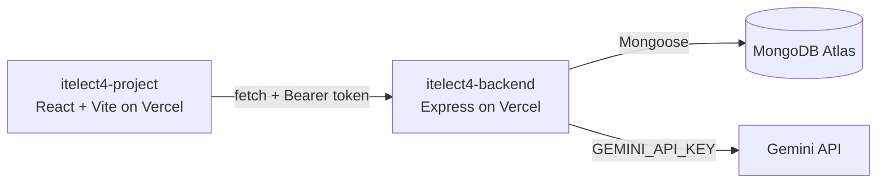

# itelect4-backend

[](https://github.com/jmikhaela/itelect4-backend/actions/workflows/ci.yml)

The REST API behind the ITELECT4 project: Express in TypeScript, MongoDB
Atlas through Mongoose, JWT login, and one route that asks Gemini to
review a project description.

- **Live API:** https://itelect4-backend-plum.vercel.app/api/health
- **Frontend repo:** https://github.com/jmikhaela/itelect4-project

## Architecture



## Run it locally

```bash
npm install
cp .env.example .env   # then fill in MONGODB_URI, JWT_SECRET, CORS_ORIGIN, GEMINI_API_KEY
npm run dev            # http://localhost:4000
npm test               # Supertest tests for POST /api/ai (no database, no Gemini call)
```

## AI-use disclosure

AI tools (Antigravity AI / Claude) were used as coding assistants during Session 12 to help generate test suites (`tests/ai.test.ts`), structure the GitHub Actions CI pipeline (`.github/workflows/ci.yml`), and configure `package.json` test scripts. All code, routes, and tests have been reviewed and verified for correctness.
